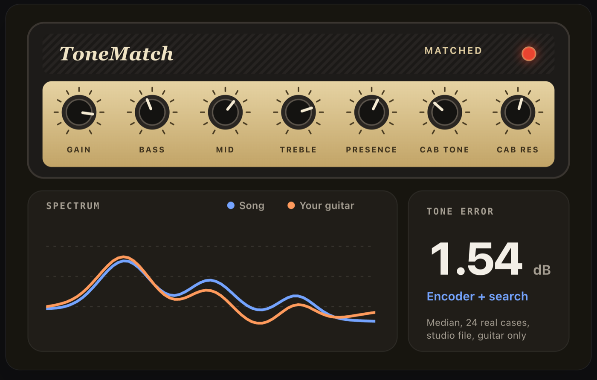
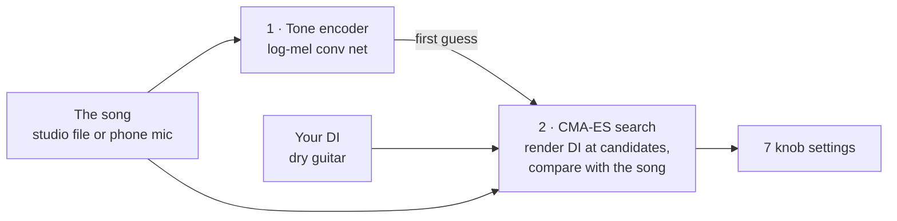
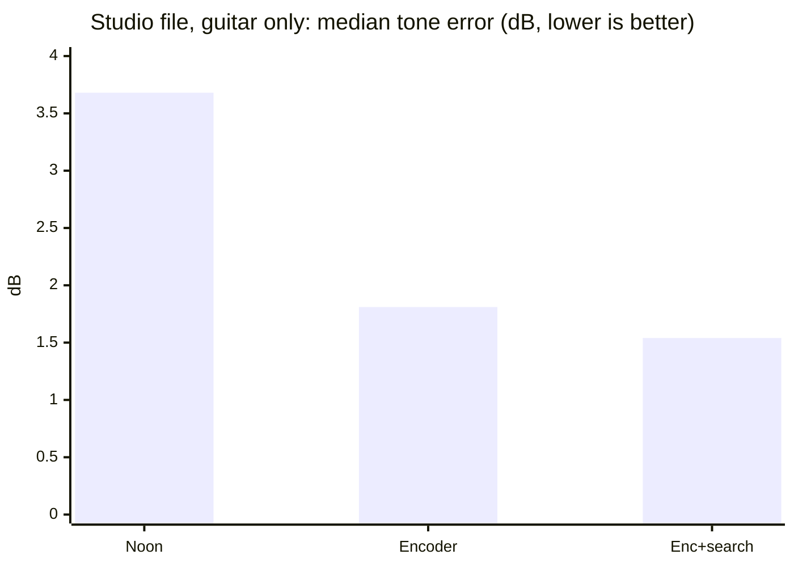
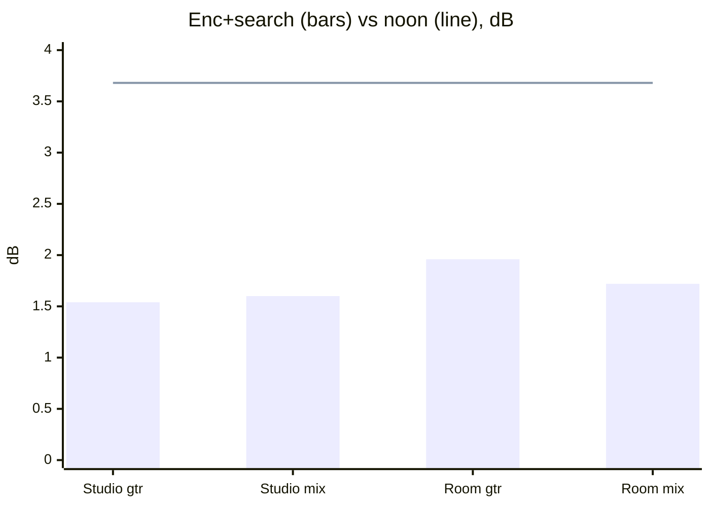
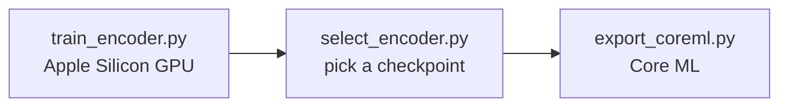

<div align="center">

# ToneMatch

**Match a guitar tone from a song's real audio.**

[](LICENSE)
[](bench/pyproject.toml)
[](swift/ToneMatch/)
[](bench/models/encoder/)
[](#quick-start)

[Project page](https://newitools.app/lab/tonematch/) · [Results](#results) · [Quick start](#quick-start)



<sub>Illustration from the project page. The 1.54 dB tone error is the measured median for a studio file, guitar only; the knob positions are illustrative.</sub>

</div>

Give it a recording of the song and your own dry guitar (DI), and it returns amp knob settings that make your guitar
sound like the record. This is the matcher behind the ToneHub guitar app.

| 58% | 24 / 24 | 3.4 MB | 7 |
|:---:|:---:|:---:|:---:|
| less tone error than knobs at noon (studio file, guitar only) | held-out real cases improved | Core ML encoder, runs on an iPhone | amp knobs predicted |

## How it works



1. **A tone encoder.** A small conv net on log-mel audio that predicts 7 amp knobs (gain, bass, mid, treble,
   presence, cab tone, cab resonance) straight from the song, plus a 128-d tone embedding. It's 3.4 MB as Core ML
   and runs on an iPhone.
2. **CMA-ES search.** Starting from the encoder's guess, it renders your DI through the amp at candidate settings and
   refines the knobs to minimize the distance to the song.

The repo also includes **tonebench**, the benchmark used to develop it.

## Results

Run 3 encoder (`bench/models/encoder/best.pt`, step 15,723). Median tone error is in dB (multi-resolution STFT
log-magnitude error on a **held-out passage**, so it measures tone rather than which notes were played). Lower is
better. The **baseline** sets every knob to noon. "Wins" counts held-out cases that beat the baseline. Each cell is
24 real cases.

Real cases are Guitar-TECHS mic'd-amp recordings, matched from a different take of the player's DI.





Studio = studio file, Room = phone mic in a room; gtr = guitar only, mix = full band mix.

| Condition | Baseline | Encoder only | Encoder + search | Wins (encoder + search) |
|---|---:|---:|---:|---:|
| Studio file, guitar only | 3.68 | 1.81 | **1.54** | 24 / 24 |
| Studio file, full band mix | 3.68 | 1.84 | **1.60** | 24 / 24 |
| Phone mic in a room, guitar only | 3.68 | **1.91** | 1.96 | 21 / 24 |
| Phone mic in a room, full band mix | 3.68 | 1.94 | **1.72** | 22 / 24 |

The encoder's prediction alone beats the baseline on 24 / 24 real cases in every condition. In the hardest setting
(a band playing through a phone speaker into a room, heard by a phone mic), encoder + search cuts tone error by 53%.

The test set is small (24 real cases), and the medians come with bootstrap intervals in the run output.
[`docs/encoder-run3.md`](docs/encoder-run3.md) compares training runs.

## What the benchmark tests

A matcher only gets what a real user has: the song and their own DI. It returns knob settings, and scoring renders a
third, held-out passage with them.

| Option | What it varies |
|---|---|
| **synthetic** track | Targets made with known settings through the bench's own gray-box amp (`tonebench/amp.py`), so knob error can be measured too. |
| **real** track | Guitar-TECHS mic'd-amp recordings, scored against the real amp on a different passage. |
| `--level` | Production on the target: `none`, `mix` (EQ + bus compression), `full` (+ reverb + MP3), `room` (iPhone listen mode: small speaker, room reflections, noise, phone mic, AGC). |
| `--band` | The guitar alone, inside a synthetic band mix, or separated back out (oracle, Demucs, Spleeter). |
| `--variant` | A different DI take, or a play-along take with timing drift and wrong notes. |

See [`bench/README.md`](bench/README.md) for every option and matcher.

## Quick start

Needs Python 3.11+ and [uv](https://docs.astral.sh/uv/).

```bash
# 1. Data (not included): download Guitar-TECHS from zenodo.org/records/14963133
#    and put it in data/guitar-techs/ at the repo root (P3_music is the benchmark set).
cd bench

# 2. Baselines (numpy only)
uv run python run.py

# 3. The released encoder, with and without search (needs torch)
uv run --group afx python run.py --matchers default pred_only pred_then_search
uv run --group afx python run.py --level room --band mix --matchers default pred_only pred_then_search

# Re-print tables from saved results
uv run python report.py results/run-*.json
```



Train your own encoder with `train_encoder.py` (Apple Silicon GPU, about 6.5 h for run 3; also needs GuitarSet in
`data/guitarset/`), pick a checkpoint with `select_encoder.py`, and export it to Core ML with `export_coreml.py`.

## Layout

| Path | What |
|---|---|
| `bench/tonebench/` | Benchmark: cases, amp model, production and room simulation, band synthesis, separation, metrics, matchers, encoder |
| `bench/run.py`, `report.py`, `paired.py` | Run the benchmark, print tables, compare runs case by case |
| `bench/train_encoder.py`, `select_encoder.py`, `export_coreml.py` | Train, select, export the encoder |
| `bench/models/encoder/` | Released weights: `best.pt` (PyTorch), `ToneEncoder.mlpackage` (Core ML), `mel_matrix.npy` (front end), `train_log.csv` |
| `bench/gearmap/` | Sketch: map a gear-neutral tone-stack curve onto a specific amp's knobs |
| `swift/ToneMatch/` | The on-device Swift code from the app: log-mel front end, Core ML runner, CMA-ES, and the matcher. Reference only: `ToneMatcher.swift` depends on the app's audio engine and doesn't build on its own |
| `docs/` | Notes comparing encoder training runs |

## License

Apache License 2.0. See [`LICENSE`](LICENSE). Third-party credits, including the datasets the released weights were
trained on, are in [`NOTICE`](NOTICE).
